# 🏥 Hospital Management System

A MySQL-based relational database project for managing and analyzing **hospital operations data**. The project builds a normalized schema from scratch, populates it with realistic sample data (patients, doctors, appointments, medical records, billing, and departments), performs CRUD operations, and runs analytical queries to extract clinical and financial insights — all using **pure SQL**.

---

## ✨ Features

- 🏗️ **Schema Design** — Build seven normalized, related tables with primary keys, foreign keys, and check constraints
- 📥 **Data Population** — Insert 50 patients, 15 doctors, 100+ appointments, medical records, billing invoices, and department mappings
- ✏️ **CRUD Operations** — Insert, update, delete, and query records across every table
- 🔗 **Relational Queries** — Multi-table joins linking patients, doctors, appointments, billing, and departments
- 📊 **Financial Metrics** — Total revenue, top-paying patients, revenue by department, cumulative monthly revenue
- 👨‍⚕️ **Doctor Analytics** — Most-visited doctor, patients per doctor, ranking by completed treatments, experience categorization
- 📅 **Date & Window Functions** — Rolling date filters, monthly visit counts, hospital stay duration, running totals, and ranking
- 🧮 **Advanced SQL** — Subqueries, CASE expressions, window functions (`RANK`, `SUM OVER`), string functions, and date formatting

---

## 🛠️ Tech Stack

- **MySQL** — Relational database engine
- **MySQL Workbench** — Query authoring & execution
- **SQL** — DDL (schema), DML (data), joins, subqueries, aggregates, window functions, and string/date functions

---

## 🧠 Skills Demonstrated

| Concept | Implementation |
|---|---|
| **Schema Design** | `Patients`, `Doctors`, `Appointments`, `Medical_Records`, `Billing`, `Departments`, `Doctor_Department` with `PRIMARY KEY` / `FOREIGN KEY` / `CHECK` constraints |
| **Data Insertion** | Multi-row `INSERT INTO ... VALUES` for all tables |
| **Data Modification** | Scoped `UPDATE` (patient address, admission/discharge dates, years of experience) |
| **Data Removal** | `DELETE` of cancelled appointments older than 6 months (with cascade) |
| **Filtering (AND / OR / NOT)** | Scheduled appointments of a specific doctor, Cardiology/Neurology doctors, patients with no recent visits |
| **Joins** | `INNER JOIN`, `LEFT JOIN`, `RIGHT JOIN`, and simulated `FULL OUTER JOIN` via `UNION` |
| **Aggregation & Grouping** | `SUM`, `COUNT`, `AVG`, `MAX`, `MIN` with `GROUP BY` and `HAVING` |
| **Subqueries** | Nested `SELECT` for highest-spending patient, Dermatology appointments, doctors above a patient threshold |
| **Window Functions** | `RANK() OVER`, running total with `ROWS BETWEEN`, cumulative revenue |
| **Date Handling** | `CURDATE()`, `DATE_SUB`, `DATE_ADD`, `DATEDIFF`, `DATE_FORMAT`, monthly grouping |
| **String Functions** | `UPPER`, `TRIM`, `COALESCE` / `NULLIF` for missing phone numbers |
| **Conditional Logic** | `CASE` for patient risk level and doctor experience level |

---

## 📊 Entity Relationship Diagram

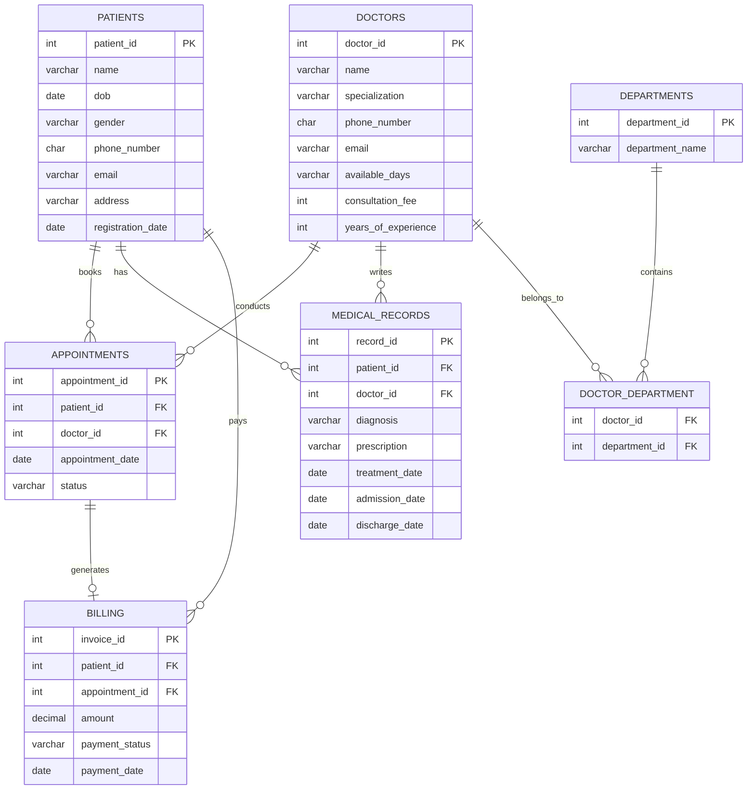

Patients book appointments with doctors; medical records and billing are linked to both; doctors are mapped to departments via a junction table — forming a fully connected, normalized schema.

---

## 📸 Screenshots

### 1️⃣ Database Creation

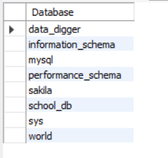
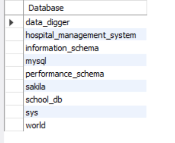

Shows the list of databases before and after `Hospital_Management_System` is created.

### 2️⃣ Patients Table & Update

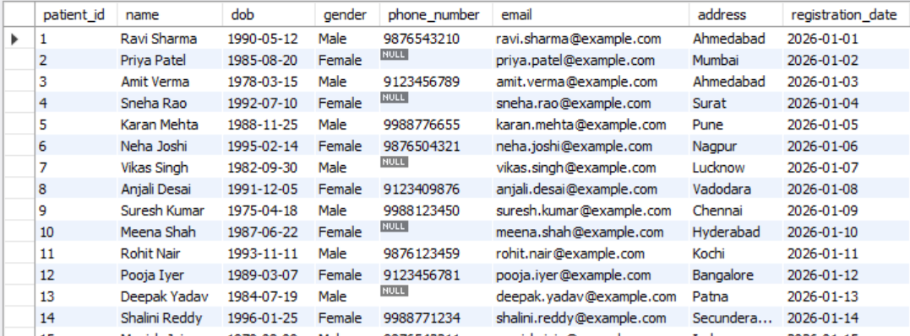

Displays seeded patient records after the address update for patient_id = 1 (changed to Ahmedabad).

### 3️⃣ Top 5 Highest-Paying Patients

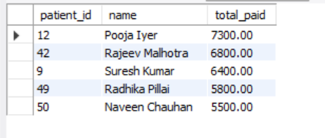

Ranking of patients by total paid amount (payment_status = 'Paid').

### 4️⃣ Doctors Charging More Than 1000

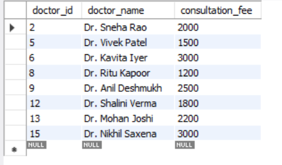

Doctors whose consultation_fee exceeds 1000.

### 5️⃣ Scheduled Appointments of Doctor 3 (AND)

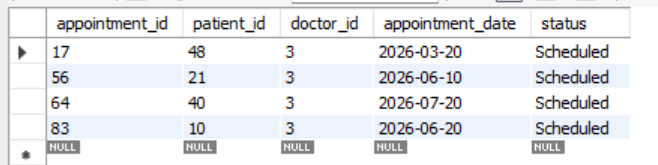

Appointments that are both Scheduled and assigned to doctor_id = 3.

### 6️⃣ Cardiology or Neurology Doctors (OR)

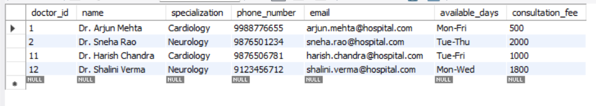

Doctors specializing in Cardiology or Neurology.

### 7️⃣ Patients with No Visit in the Past Year (NOT)

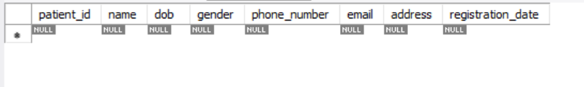

Patients who have not appeared in any appointment within the last year (result set empty with current sample data).

### 8️⃣ Doctors Sorted by Specialization

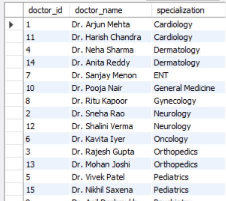

All doctors ordered alphabetically by specialization.

### 9️⃣ Number of Patients per Doctor

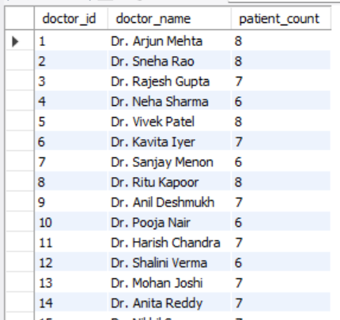

Count of distinct patients seen by each doctor (LEFT JOIN + GROUP BY).

### 🔟 Total Revenue per Department

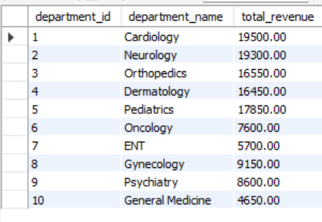

Sum of paid invoice amounts grouped by department (via Doctor_Department mapping).

### 1️⃣1️⃣ Total Revenue Collected

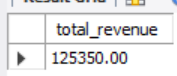

Overall sum of all paid invoices: **125,350.00**.

### 1️⃣2️⃣ Most Visited Doctor

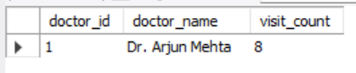

Doctor with the highest number of appointments (Dr. Arjun Mehta — 8 visits).

### 1️⃣3️⃣ Average, Highest & Lowest Consultation Fee

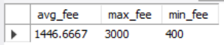

Aggregate statistics on doctors' consultation fees.

### 1️⃣4️⃣ Foreign Key Verification

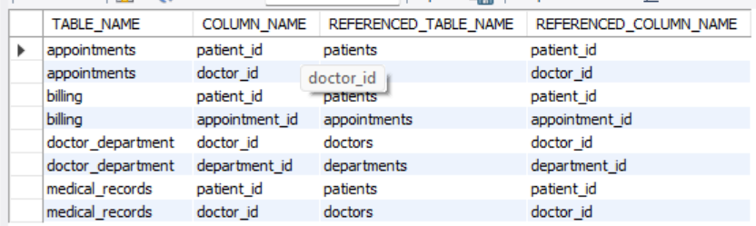

Query against `information_schema.KEY_COLUMN_USAGE` confirming all foreign-key relationships.

### 1️⃣5️⃣ Doctors with Department Names (INNER JOIN)

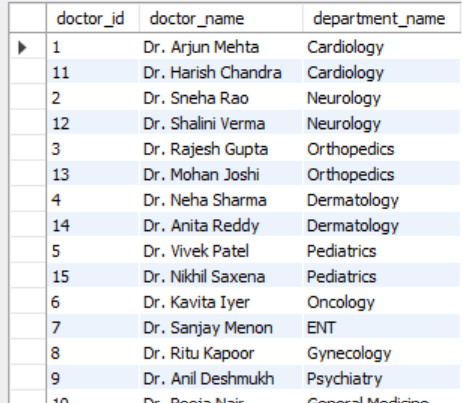

Inner join of Doctors → Doctor_Department → Departments.

### 1️⃣6️⃣ Patients with Completed Appointments (LEFT JOIN)

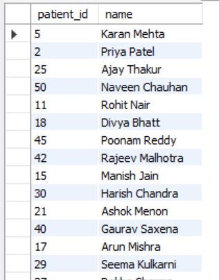

Distinct patients who have at least one Completed appointment.

### 1️⃣7️⃣ Appointments with No Payment (RIGHT JOIN)

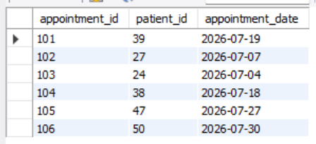

Appointments that have no corresponding billing record.

### 1️⃣8️⃣ Patients Who Never Booked an Appointment

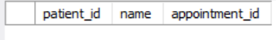

Simulated FULL OUTER JOIN result showing patients with no appointments (empty with current data).

### 1️⃣9️⃣ Doctors Who Handled More Than 50 Patients

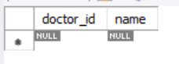

Subquery result (empty — sample data uses a lower threshold of 5 in comments).

### 2️⃣0️⃣ Patient Who Spent the Most

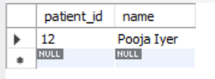

Patient with the highest total paid amount (Pooja Iyer).

### 2️⃣1️⃣ Appointments with Dermatology Doctors

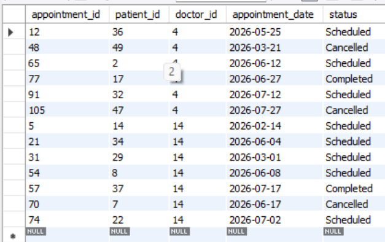

All appointments where the doctor specializes in Dermatology (subquery).

### 2️⃣2️⃣ Visits per Month

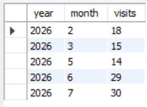

Appointment counts grouped by year and month.

### 2️⃣3️⃣ Hospital Stay Duration

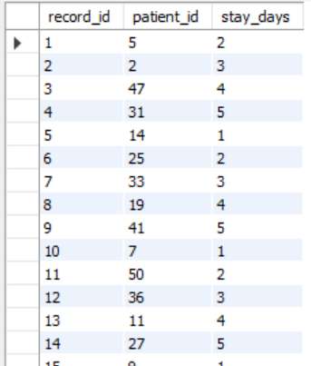

`DATEDIFF(discharge_date, admission_date)` after adding and populating the new columns.

### 2️⃣4️⃣ Formatted Treatment Date (DD-MM-YYYY)

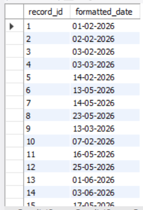

`DATE_FORMAT(treatment_date, '%d-%m-%Y')` output.

### 2️⃣5️⃣ Patient Names in Uppercase

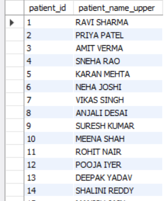

`UPPER(name)` applied to the Patients table.

### 2️⃣6️⃣ Trimmed Doctor Names

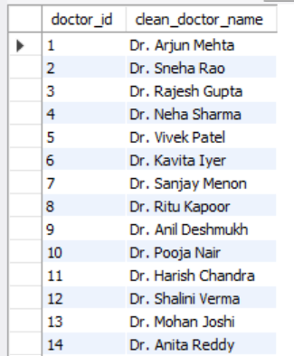

`TRIM(name)` for clean doctor name display.

### 2️⃣7️⃣ Missing Phone Numbers Replaced

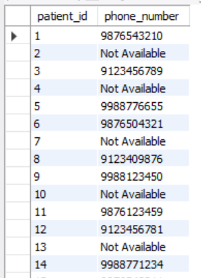

`COALESCE(NULLIF(TRIM(phone_number), ''), 'Not Available')` for patients without a phone number.

### 2️⃣8️⃣ Rank Doctors by Patients Treated

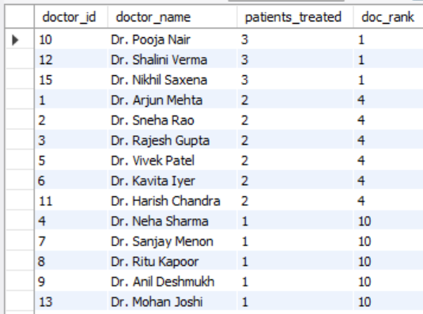

`RANK() OVER (ORDER BY COUNT(DISTINCT patient_id) DESC)` on completed appointments.

### 2️⃣9️⃣ Cumulative Revenue per Month

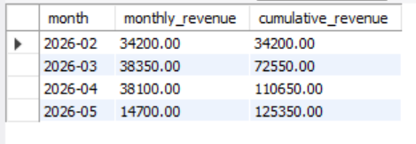

Monthly paid revenue with a running cumulative total using a window function.

### 3️⃣0️⃣ Running Total of Appointments

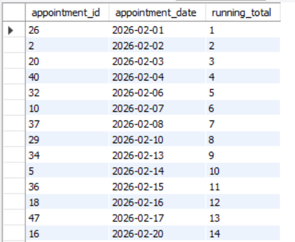

Appointment-level running count ordered by date.

### 3️⃣1️⃣ Patient Risk Level

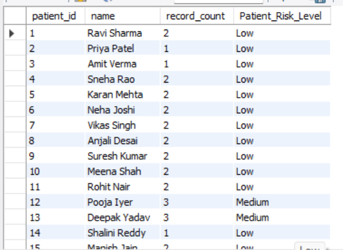

`CASE` expression classifying patients as High / Medium / Low based on number of medical records.

### 3️⃣2️⃣ Doctors Categorized by Experience

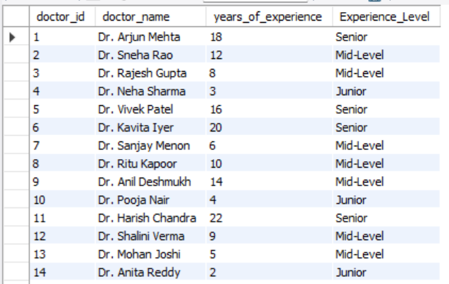

`CASE` expression labeling doctors as Senior / Mid-Level / Junior after adding `years_of_experience`.

---

## 📌 Key Results

| Metric | Result |
|---|---:|
| **Total Revenue (Paid)** | 125,350.00 |
| **Top-Paying Patient** | Pooja Iyer (7,300.00) |
| **Most Visited Doctor** | Dr. Arjun Mehta (8 visits) |
| **Highest Consultation Fee** | 3,000 |
| **Lowest Consultation Fee** | 400 |
| **Average Consultation Fee** | ≈ 1,446.67 |
| **Top Revenue Department** | Cardiology (19,500.00) |
| **Peak Appointment Month** | July 2026 (30 visits) |

---

## 📁 Project Structure

```text
Hospital_Management_System/
├── hospital_management.sql   # Full SQL script (schema + data + queries)
├── README.md                 # Project documentation
└── Screenshots/
    ├── Screenshot-1.png      # Databases before
    ├── Screenshot-2.png      # Databases after
    ├── Screenshot-3.png      # Patients table
    ├── Screenshot-4.png      # Top 5 paying patients
    ├── Screenshot-5.png      # Doctors fee > 1000
    ├── Screenshot-6.png      # Doctor 3 scheduled
    ├── Screenshot-7.png      # Cardio / Neuro doctors
    ├── Screenshot-8.png      # No recent visit
    ├── Screenshot-9.png      # Doctors by specialization
    ├── Screenshot-10.png     # Patients per doctor
    ├── Screenshot-11.png     # Revenue per department
    ├── Screenshot-12.png     # Total revenue
    ├── Screenshot-13.png     # Most visited doctor
    ├── Screenshot-14.png     # Fee statistics
    ├── Screenshot-15.png     # Foreign keys
    ├── Screenshot-16.png     # Doctors + departments
    ├── Screenshot-17.png     # Completed appointments
    ├── Screenshot-18.png     # Unpaid appointments
    ├── Screenshot-19.png     # Never booked
    ├── Screenshot-20.png     # High-volume doctors
    ├── Screenshot-21.png     # Top spender
    ├── Screenshot-22.png     # Dermatology appointments
    ├── Screenshot-23.png     # Visits per month
    ├── Screenshot-24.png     # Stay duration
    ├── Screenshot-25.png     # Formatted dates
    ├── Screenshot-26.png     # Uppercase names
    ├── Screenshot-27.png     # Trimmed names
    ├── Screenshot-28.png     # Phone coalesce
    ├── Screenshot-29.png     # Doctor ranking
    ├── Screenshot-30.png     # Cumulative revenue
    ├── Screenshot-31.png     # Running total
    ├── Screenshot-32.png     # Patient risk level
    └── Screenshot-33.png     # Experience level
```

---

## ▶️ How to Run

### 1. Clone or download the project

Place `hospital_management.sql` in your working directory.

### 2. Open a MySQL client

Use MySQL Workbench or any MySQL-compatible client.

### 3. Run the script

```sql
SOURCE hospital_management.sql;
```

This creates the `Hospital_Management_System` database, builds all seven tables, seeds them with sample data, runs the full set of CRUD and analytical queries, and finally deletes old cancelled appointments.

> **Note:** Some queries (e.g., “patients with no visit in the past year”, “doctors with > 50 patients”) return empty result sets with the provided sample data because all appointments fall within the current year and patient counts are modest. The comments in the script indicate how to adjust thresholds if you want to see rows.

---

## 🧭 Script Sections

```text
1. Database & Table Setup
2. Sample Data Insertion (Patients, Doctors, Appointments, Medical Records, Billing, Departments)
3. Task 1 — UPDATE patient address + DELETE old cancelled appointments
4. Task 2 — Date filters & top-N queries
5. Task 3 — AND / OR / NOT conditions
6. Task 4 — ORDER BY, GROUP BY, revenue by department
7. Task 5 — Aggregates (total revenue, most-visited doctor, fee stats)
8. Task 6 — Foreign-key inspection
9. Task 7 — INNER / LEFT / RIGHT / simulated FULL OUTER JOIN
10. Task 8 — Subqueries
11. Task 9 — Date functions, ALTER TABLE, stay duration, formatting
12. Task 10 — String functions (UPPER, TRIM, COALESCE)
13. Task 11 — Window functions (RANK, cumulative sum, running total)
14. Task 12 — CASE expressions (risk level, experience level)
```

---

## 📊 Dataset Information

The schema is made up of **7 tables**:

| Table | Key Columns |
|---|---|
| **Patients** | patient_id, name, dob, gender, phone_number, email, address, registration_date |
| **Doctors** | doctor_id, name, specialization, phone_number, email, available_days, consultation_fee, years_of_experience |
| **Appointments** | appointment_id, patient_id, doctor_id, appointment_date, status |
| **Medical_Records** | record_id, patient_id, doctor_id, diagnosis, prescription, treatment_date, admission_date, discharge_date |
| **Billing** | invoice_id, patient_id, appointment_id, amount, payment_status, payment_date |
| **Departments** | department_id, department_name |
| **Doctor_Department** | doctor_id, department_id (composite PK) |

All relationships are enforced with foreign keys and `ON DELETE CASCADE` where appropriate.

---

## 💼 Why This Project Matters

This project demonstrates practical skills relevant to entry-level **SQL, Database Management, and Healthcare Data Analysis** work:

- ✅ Designing a normalized multi-table relational schema
- ✅ Enforcing referential integrity with foreign keys and check constraints
- ✅ Writing safe, scoped `UPDATE` / `DELETE` statements
- ✅ Multi-table joins (including simulated full outer join) to answer real operational questions
- ✅ Aggregate, grouped, and ranked queries for reporting
- ✅ Subqueries for targeted lookups
- ✅ Date arithmetic, window functions, and conditional logic
- ✅ String cleaning and null-handling techniques

---

## 👨‍💻 Author

**Akshar Tailor**

---

⭐ If you found this project useful, consider giving it a star!
